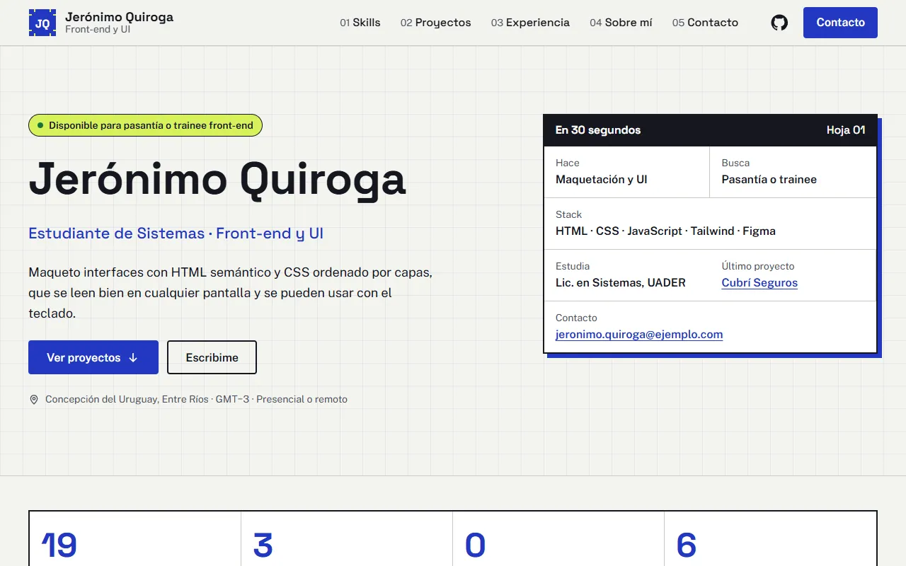
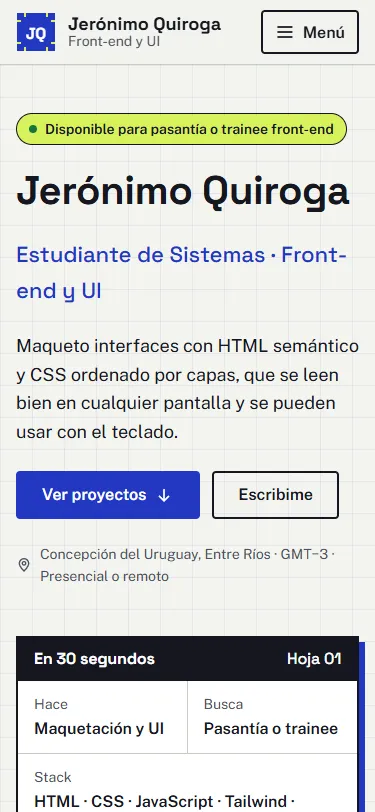
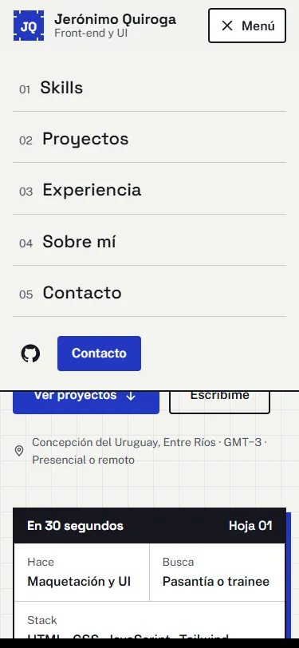
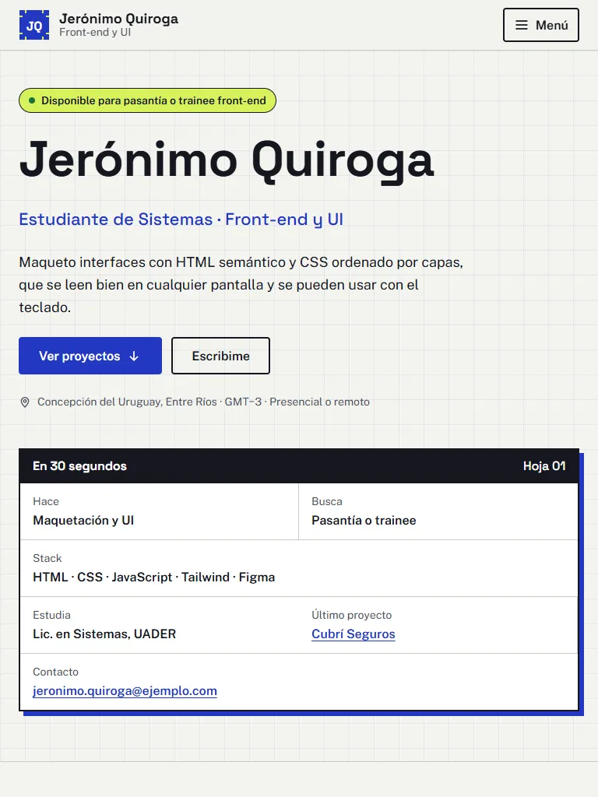

# Portfolio de Jerónimo Quiroga

Trabajo final de **Diseño UX-UI 2026**. Licenciatura en Sistemas de Información, FCyT UADER.

| | |
|---|---|
| **Sitio publicado** | https://jeronimo-quiroga.netlify.app/ |
| **Figma** | [Research, wireframes, design system y prototipo](https://www.figma.com/design/HTZRE2wvCzUaSlE8xcbTwy) |
| **Proceso (PDF)** | [docs/proceso.pdf](docs/proceso.pdf) |
| **Test de usabilidad** | [docs/test-usabilidad.md](docs/test-usabilidad.md) |
| **Lighthouse (mobile)** | [Captura](docs/lighthouse-mobile.png) |



## Stack

HTML5, CSS3 y JavaScript vanilla, sin frameworks ni paso de build. Se publica en Netlify en cada push a `main`.

- **CSS por capas:** `@layer tokens, base, layout, components, utilities`, con nombres de clase BEM, la misma organización que usé en Coffea.
- **Tipografías:** Space Grotesk y Public Sans, autoalojadas con `font-display: swap`.
- **Imágenes:** WebP con `width`, `height` y `loading="lazy"` debajo del pliegue.
- **JavaScript:** solo el menú mobile y la sección actual en el menú. El contenido se lee sin JavaScript.
- **Formulario:** Netlify Forms, sin backend propio.

## Concepto: Plano

Un plano técnico tiene estructura, medidas y un rótulo que dice qué es cada hoja. Las tres palabras de la marca son **estructurado, preciso y directo**:

- **Color:** cobalto como tinta de plano, lima solo para lo que hay que ver (disponibilidad y contacto), papel claro de fondo.
- **Tipografía:** Space Grotesk en títulos y Public Sans en texto.
- **Imágenes:** grilla de 32 px, el rótulo "En 30 segundos" en el hero y un retrato dibujado como plano.

El detalle (proto-persona, benchmark, moodboard, card sorting) está en Figma y en el PDF de proceso.

## Estructura

```
├── index.html             página principal (one-page con anclas)
├── casos/                 casos de estudio: Cubrí Seguros y Coffea
├── 404.html               página no encontrada
├── gracias.html           confirmación del formulario
├── css/tokens.css         variables del design system, iguales a las de Figma
├── css/main.css           estilos mobile-first por capas
├── css/sin-js.css         menú visible si JavaScript está desactivado
├── js/main.js             menú mobile y sección actual
├── assets/                fuentes e imágenes
├── docs/                  proceso, test, Lighthouse, capturas y HTML para Figma
└── netlify.toml           deploy y headers de seguridad
```

**Orden de las secciones:** se mantiene el de la referencia (Skills antes que Proyectos) porque quien evalúa un perfil front-end filtra primero por stack. Para que no sea una lista sin pruebas, cada skill termina con "Visto en" y un enlace al proyecto que la demuestra.

## Requisitos verificados

| Requisito | Resultado | Cómo se comprobó |
|---|---|---|
| Lighthouse mobile ≥ 90 | 100 en Performance, Accessibility, Best Practices y SEO | Lighthouse 13 sobre la URL publicada |
| WCAG 2.2 AA | Sin violaciones | axe-core en 5 páginas y 3 anchos |
| Responsive sin scroll horizontal | 375, 768 y 1280 px | Chrome headless y revisión de capturas |
| Teclado | Recorrido completo, foco visible y enlace "Saltar al contenido" | Recorrido con Tab |
| Menú mobile | `aria-expanded`, `aria-controls` y cierre con Escape | Chrome headless |
| Movimiento reducido | Transiciones desactivadas con `prefers-reduced-motion` | Revisión del CSS |

| Mobile | Menú | Tablet |
|---|---|---|
|  |  |  |

## Validación

**Estado: hecho**, con 4 familiares.

1. **Opinión general.** Dijeron que está bueno y no vieron problemas.
2. **Test con 4 tareas:** entender a qué me dedico y qué busco, encontrar cómo contactarme, abrir el proyecto más reciente y usar el menú mobile. **Las 4 personas completaron las 4 tareas sin dudar (16 de 16).**

No aparecieron problemas, así que no hubo cambios. Como las personas son cercanas, el resultado puede ser más favorable de lo normal; el próximo paso sería probarlo con alguien que evalúe perfiles. Guía, planilla y resultados en [docs/test-usabilidad.md](docs/test-usabilidad.md).

## Correr en local

No hace falta compilar. Con la extensión Live Server de VS Code, o con:

```bash
python -m http.server 8000
```

## Deploy en Netlify

1. Subir el repositorio a GitHub (público).
2. En [app.netlify.com](https://app.netlify.com): **Add new project → Import an existing project → GitHub** y elegir este repositorio.
3. Dejar **Build command** vacío y **Publish directory** en `.` (ya está en `netlify.toml`). Tocar **Deploy**.
4. En **Project configuration → Change project name**, poner `jeronimo-quiroga` para que la URL sea `jeronimo-quiroga.netlify.app`.
5. En **Forms**, activar **Enable form detection** y volver a desplegar, para que funcione el formulario de contacto.
6. Desde ahí, cada push a `main` se publica solo. La URL también va en la descripción del repositorio (**About → Website**).

## Bonus

- Formulario de contacto funcional con Netlify Forms y campo anti-spam.
- Headers de seguridad en `netlify.toml`: `X-Content-Type-Options`, `X-Frame-Options`, `Referrer-Policy` y `Permissions-Policy`. No lleva Content Security Policy porque el plan gratuito de Netlify inyecta el badge "Powered by Netlify" con código inline, y una CSP estricta lo bloquea.
- Página 404 personalizada.
- Dos casos de estudio con navegación entre ellos.
- Microinteracciones: tarjetas que se levantan con sombra de plano, subrayado animado en el menú y sección actual marcada.

## Créditos y recursos

- **Templates:** no se usó ninguno.
- **Fuentes:** [Space Grotesk](https://fonts.google.com/specimen/Space+Grotesk) y [Public Sans](https://fonts.google.com/specimen/Public+Sans), licencia OFL, vía Fontsource.
- **Íconos:** dibujados en SVG para este sitio. Los logos de GitHub y LinkedIn pertenecen a sus empresas.
- **Capturas de proyectos:** Cubrí Seguros, Coffea y los ejercicios son trabajos propios de la cursada.
- **Verificación:** Lighthouse y axe-core.

## Uso de IA

Se usó un asistente de IA para generar el código del sitio, los textos (a partir de mis repositorios y trabajos reales), los archivos para Figma y el PDF de proceso.

**Cómo se revisó:** los datos se compararon con mis repositorios (cantidades, tecnologías, fórmulas y resultados). Accesibilidad, responsive y performance se midieron con las herramientas de la tabla anterior. Revisé los textos y completé los datos personales antes de la entrega.
